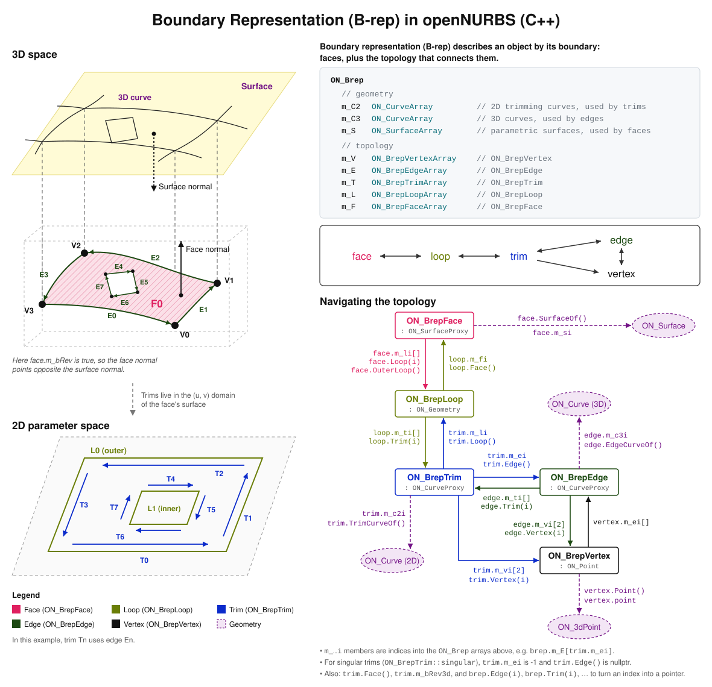

+++
aliases = ["/en/5/guides/cpp/brep-data-structure/", "/en/6/guides/cpp/brep-data-structure/", "/en/7/guides/cpp/brep-data-structure/", "/en/wip/guides/cpp/brep-data-structure/"]
authors = [ "dale" ]
categories = [ "Fundamentals" ]
description = "This guide discusses the Boundary Representation (B-rep) in the context of openNURBS."
keywords = [ "rhino", "brep", "openNURBS", "data" ]
languages = [ "C/C++" ]
sdk = [ "C/C++" ]
title = "B-rep Data Structure"
type = "guides"
weight = 4

[admin]
TODO = "needs explanation, diagram style update"
origin = "http://wiki.mcneel.com/developer/brepstructure"
picky_sisters = ""
state = ""

[included_in]
platforms = [ "Windows", "Mac" ]
since = 0

[page_options]
byline = true
toc = true
toc_type = "single"
+++


## Conceptual diagram



## Sample

```cpp
/*
Description:
  Gets the indices of the trims and edges used by a brep face.
Parameters:
  brep              - [in] The brep.
  face_index        - [in] Index of the face in brep.m_F[].
  face_trim_indices - [out] Indices into brep.m_T[] of the face's trims.
  face_edge_indices - [out] Indices into brep.m_E[] of the face's edges.
Returns:
  true if successful, false if face_index is out of range.
*/
bool GetFaceTrimsAndEdges(
  const ON_Brep& brep,
  int face_index,
  ON_SimpleArray<int>& face_trim_indices,
  ON_SimpleArray<int>& face_edge_indices
)
{
  face_trim_indices.Empty();
  face_edge_indices.Empty();

  // Get the face at the given index
  const ON_BrepFace* face = brep.Face(face_index);
  if (nullptr == face)
    return false;

  // Walk the loops of the face
  for (int fli = 0; fli < face->LoopCount(); fli++)
  {
    const ON_BrepLoop* loop = face->Loop(fli);
    if (nullptr == loop)
      continue;

    // Walk the trims of the loop
    for (int lti = 0; lti < loop->TrimCount(); lti++)
    {
      const ON_BrepTrim* trim = loop->Trim(lti);
      if (nullptr == trim)
        continue;
      face_trim_indices.Append(trim->m_trim_index);

      // Get the edge the trim uses.
      // Singular trims have no edge, so trim->Edge() is nullptr for them.
      const ON_BrepEdge* edge = trim->Edge();
      if (nullptr == edge)
        continue;
      face_edge_indices.Append(edge->m_edge_index);
    }
  }

  return true;
}
```
