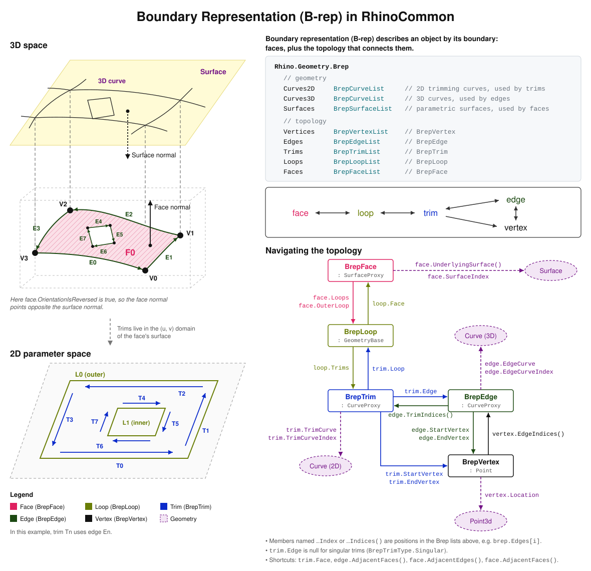

+++
aliases = [""]
authors = [ "dale" ]
categories = [ "Fundamentals" ]
description = "This guide discusses the Boundary Representation (B-rep) in the context of RhinoCommon."
keywords = [ "rhino", "brep", "RhinoCommon", "data" ]
languages = [ "C#" ]
sdk = [ "RhinoCommon" ]
title = "B-rep Data Structure"
type = "guides"
weight = 1

[admin]
TODO = ""
origin = "http://wiki.mcneel.com/developer/brepstructure"
picky_sisters = ""
state = ""

[included_in]
platforms = [ "Windows", "Mac" ]
since = 0

[page_options]
byline = true
toc = true
toc_type = "single"
+++


## Conceptual diagram



## Sample

```csharp
using System.Collections.Generic;
using Rhino.Geometry;

static class BrepFaceTopologySample
{
  /// <summary>
  /// Gets the indices of the trims and edges used by a Brep face.
  /// </summary>
  /// <param name="brep">The Brep.</param>
  /// <param name="faceIndex">Index of the face in brep.Faces.</param>
  /// <param name="faceTrimIndices">Indices into brep.Trims of the face's trims.</param>
  /// <param name="faceEdgeIndices">Indices into brep.Edges of the face's edges.</param>
  /// <returns>true if successful, false if the face index is out of range.</returns>
  public static bool GetFaceTrimsAndEdges(
    Brep brep, 
    int faceIndex, 
    out List<int> faceTrimIndices, 
    out List<int> faceEdgeIndices
  )
  {
    faceTrimIndices = new List<int>();
    faceEdgeIndices = new List<int>();

    // Get the BrepFace at the given index
    if (null == brep || faceIndex < 0 || faceIndex >= brep.Faces.Count)
      return false;
    BrepFace face = brep.Faces[faceIndex];

    // Walk the loops of the face
    foreach (BrepLoop loop in face.Loops)
    {
      // Walk the trims of the loop
      foreach (BrepTrim trim in loop.Trims)
      {
        faceTrimIndices.Add(trim.TrimIndex);

        // Get the edge the trim uses.
        // Singular trims have no edge, so trim.Edge is null for them.
        BrepEdge edge = trim.Edge;
        if (null == edge)
          continue;
        faceEdgeIndices.Add(edge.EdgeIndex);
      }
    }

    return true;
  }
}
```
